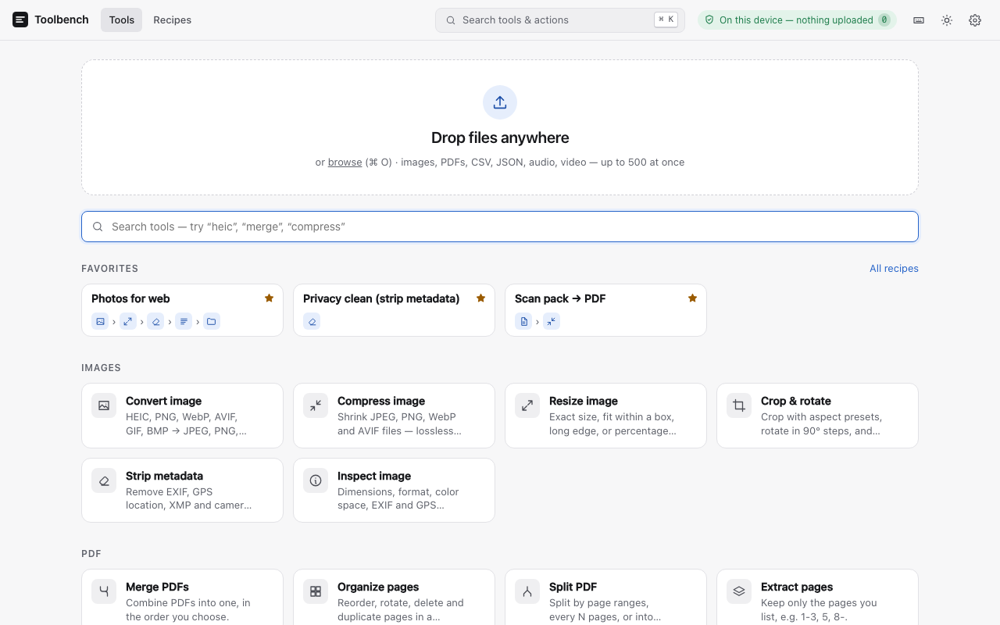
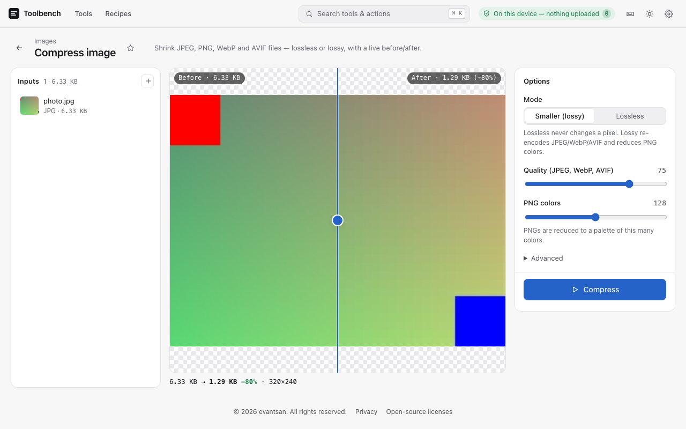
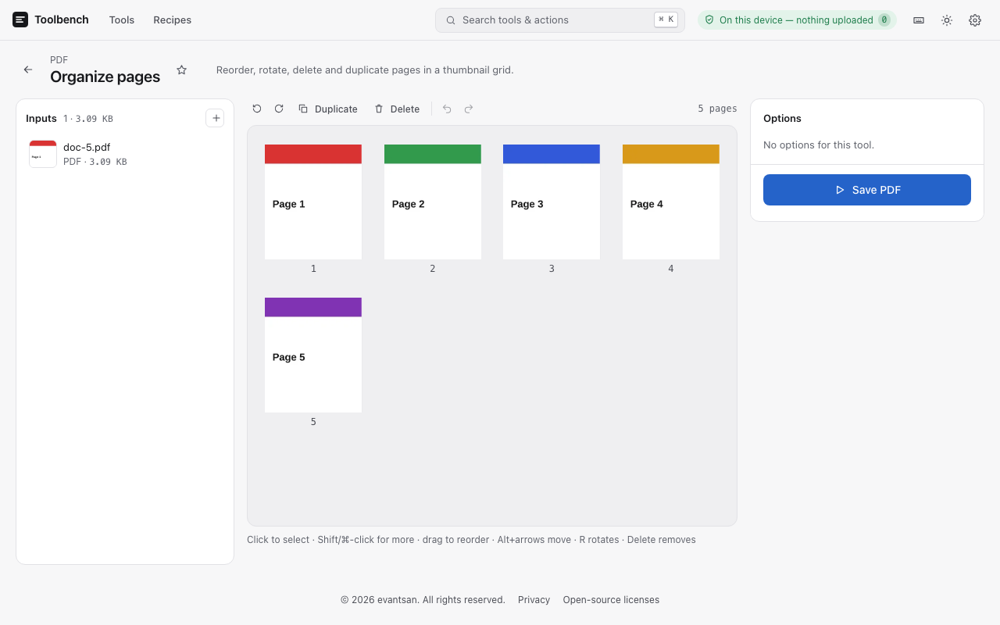
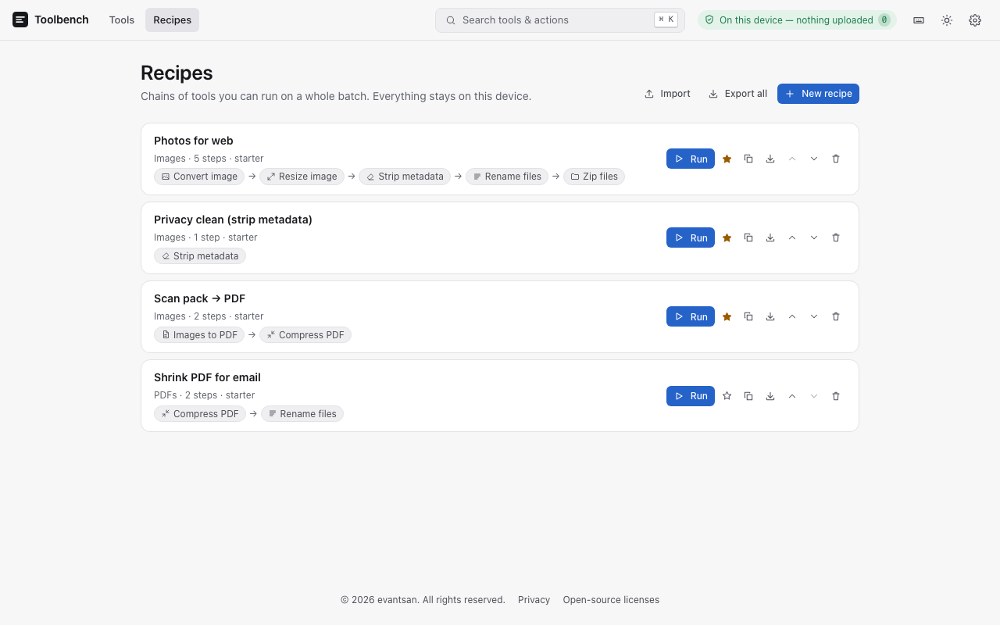

# Toolbench for Windows

**A private toolbox for files and data. Everything runs on your device.**

Convert, compress, edit and batch-process images, PDFs, data, text, audio and video. 
No uploads, no accounts, no ads, no limits, and it works offline.

 

### [⬇&nbsp; Download for Windows](https://github.com/evantsan/toolbench-releases/releases/latest/download/Toolbench-setup-x64.exe)

Windows 10 and 11 (64-bit) · free · [all versions and the .msi installer](https://github.com/evantsan/toolbench-releases/releases)

  

<picture>
  <source media="(prefers-color-scheme: dark)" srcset="images/home-dark.png">
  
</picture>

---

## Why Toolbench

- **Your files never leave your computer.** There is no server to send them to. Every tool runs locally, and the app makes no network requests at all unless you turn on the optional update check.
- **Works offline.** Every engine is bundled with the installer, so nothing downloads on first use.
- **Native on Windows.** Real Save and Open dialogs, an optional "save straight to this folder" setting, and "Open with Toolbench" for images, PDFs, text and data files.
- **Built for batches.** Drop up to 500 files at once, or chain tools into _recipes_ such as `HEIC → JPG → resize → strip metadata → zip`. One bad file never fails the batch.
- **Compressors never make a file bigger.** If a file can't be shrunk, you get the original back.

## What's inside

37 tools, all reachable from the command palette (<kbd>Ctrl</kbd> + <kbd>K</kbd>).

| Category          | Tools                                                                                                                                                                                      |
| ----------------- | ------------------------------------------------------------------------------------------------------------------------------------------------------------------------------------------ |
| **Images**        | Convert (HEIC, PNG, WebP, AVIF, GIF, BMP → JPEG, PNG, WebP, AVIF) · Compress with a live before/after · Resize · Crop & rotate · Strip metadata (EXIF, GPS) · Inspect                      |
| **PDF**           | Merge · Organize pages · Split · Extract or delete pages · Images to PDF · PDF to images · PDF to text · Rotate pages · Compress · Sign · Fill forms · Page numbers · Watermark · and more |
| **Audio & video** | Trim · Compress video and audio · Video to GIF or WebP · Extract audio · Convert audio (MP3, AAC, Ogg, WAV, FLAC) · Mute · Resize video                                                    |
| **Data & text**   | CSV editor · CSV ↔ JSON · Split CSV · Format JSON · Compare text · Extract text from photos and scans (OCR, 9 languages)                                                                   |
| **Utilities**     | Checksums (SHA-256, SHA-1, MD5) · Make or read QR codes · Batch rename · Zip files                                                                                                         |

<table>
  <tr>
    <td width="50%">
      <picture>
        <source media="(prefers-color-scheme: dark)" srcset="images/compress-dark.png">
        
      </picture>
      
Compress with a live before/after

    </td>
    <td width="50%">
      <picture>
        <source media="(prefers-color-scheme: dark)" srcset="images/organize-dark.png">
        
      </picture>
      
Reorder, rotate and delete PDF pages

    </td>
  </tr>
  <tr>
    <td colspan="2">
      <picture>
        <source media="(prefers-color-scheme: dark)" srcset="images/recipes-dark.png">
        
      </picture>
      
Recipes chain tools together and run them on a whole batch

    </td>
  </tr>
</table>

## Installing

1. Download **[Toolbench-setup-x64.exe](https://github.com/evantsan/toolbench-releases/releases/latest/download/Toolbench-setup-x64.exe)** and run it.
2. **Windows may show "Windows protected your PC".** The installer isn't code-signed yet, so SmartScreen doesn't recognize it. Click **More info**, then **Run anyway**.
3. Toolbench installs for your user account, with no admin rights needed, and appears in the Start menu.

Prefer an MSI for managed or silent installs? It's attached to every [release](https://github.com/evantsan/toolbench-releases/releases).

**Updating:** download and run the newest installer over your current version; your recipes and settings are kept. To be told when a new version is out, turn on **Settings → Check for new versions** (off by default).

**Uninstalling:** Windows **Settings → Apps → Installed apps → Toolbench → Uninstall**.

## Privacy

Toolbench processes every file on your computer. It has no accounts, analytics, telemetry or crash reporting. The only network request it can make is the optional update check, which asks GitHub for the latest release when you turn it on. The full privacy policy and terms of use are in the app, under **Settings → About**.

## About this repository

This repository only hosts Toolbench's Windows installers and release notes. The source code is developed privately. Each release is published here automatically after it passes the desktop self-test.

 
© 2026 Evan Tsan. All rights reserved. Toolbench is free to use under its <b>terms of use</b> (in the app, under Settings → About). Open-source components remain under their own licenses, listed in the app.

